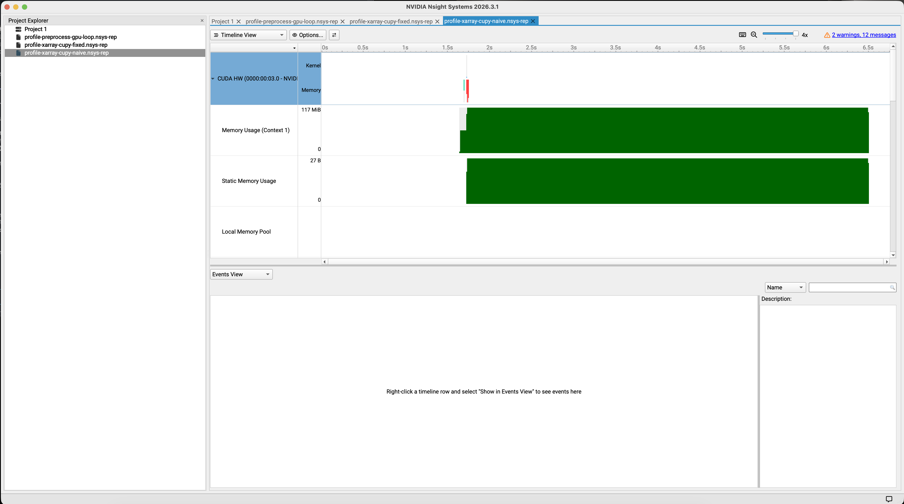

# Profile GPU workloads

Monitoring tells you whether the GPU is busy. Profiling tells you where the time goes. This page uses one example, a GPU port that isn't as fast as it should be, to show what two complementary profilers reveal:

- [`cProfile`](https://docs.python.org/3/library/profile.html) and [SnakeViz](https://jiffyclub.github.io/snakeviz/) show where Python spends time on the CPU.
- [Nsight Systems](https://developer.nvidia.com/nsight-systems) (`nsys`) shows what the GPU actually does over time: kernels, memory transfers, and the CUDA calls that drive them.

```{note}
This page focuses on the tools. For a step-by-step walkthrough that also fixes the example and covers more performance pitfalls, see the [Monitoring and Debugging](https://github.com/rapidsai-community/gpu-deployment-tutorial/blob/main/5-monitoring-and-debugging.md) module of the GPU deployment tutorial.
```

## The example: a GPU port that isn't faster

The example is an empirical orthogonal function (EOF) analysis, which is principal component analysis applied to gridded climate data. It reshapes a year of global air temperature data from the [NCEP/NCAR Reanalysis](https://psl.noaa.gov/data/gridded/data.ncep.reanalysis.html) into a `(time, space)` matrix, subtracts the mean at each grid point, and runs a singular value decomposition (SVD).

The example script, {download}`xarray-cupy-naive.py <scripts/xarray-cupy-naive.py>`, is a GPU port of this analysis with CuPy:

```{literalinclude} scripts/xarray-cupy-naive.py
:language: python
:lines: 4-
```

To run it, download the dataset (about 22 MB) into your working directory and install the dependencies into a GPU environment:

```bash
wget https://downloads.psl.noaa.gov/Datasets/ncep.reanalysis/surface/air.sig995.2025.nc
conda install -c conda-forge xarray netcdf4 cupy snakeviz
```

The GPU port runs without errors and the GPU is in use, as `nvtop` shows (see {doc}`monitoring`). But on an NVIDIA L4 it takes about 5.5 seconds, slightly slower than the same analysis on the CPU with NumPy, which takes about 5.0 seconds. The [CPU baseline](https://github.com/rapidsai-community/gpu-deployment-tutorial/blob/main/5-monitoring-and-debugging.md#establishing-a-cpu-baseline) is in the GPU deployment tutorial. The rest of this page uses the profilers to find out why the GPU port isn't faster.

## Python view: cProfile and SnakeViz

`cProfile` is Python's built-in function profiler. It records which Python functions ran, how many times, and how long each one took. SnakeViz renders the resulting `.prof` file as an interactive chart in your browser.

Profile the GPU port and open the result:

```bash
python -m cProfile -o profile-xarray-cupy-naive.prof xarray-cupy-naive.py
python -m snakeviz -s profile-xarray-cupy-naive.prof
```

SnakeViz starts a local web server, by default at `http://127.0.0.1:8080`. If you run it on a remote machine, forward port `8080` to your computer, then open the URL in your local browser.

% TODO: Add a SnakeViz screenshot of xarray-cupy-naive.py.
% On a GPU machine, run the two commands above, wait for the icicle chart to load,
% and take a screenshot that shows the svd block and the smaller cupy blocks.
% Save it as source/images/debugging-snakeviz-xarray-cupy-naive.png and add it here as a
% Markdown image (path ../images/...), with alt text such as
% "SnakeViz icicle chart of xarray-cupy-naive.py, where NumPy's svd call takes most of the runtime".
% Check that the description below matches what the screenshot shows.

The largest block in the icicle chart is the `svd` call from NumPy's `_linalg.py`, which takes most of the runtime. The CuPy calls for the reshape and mean subtraction are small. That's the first clue: the expensive step isn't running in CuPy on the GPU. It's running in NumPy, on the CPU.

`cProfile` has limits for GPU code, though. It only sees Python function calls on the CPU. It can't see GPU kernels or memory transfers. Because GPU work is asynchronous, the time a kernel takes often shows up in whichever Python call waits for it, such as a copy back to the host or a `synchronize()`, not in the call that launched it. To see what the GPU is doing, you need a timeline.

## GPU view: Nsight Systems

Nsight Systems records a timeline of everything that happens across the CPU and GPU during a run: the CUDA API calls that your Python code makes, the kernels that run on the GPU, the copies between host and device memory, and GPU memory usage. Where `cProfile` tells you which Python function was slow, Nsight Systems shows you what the GPU was doing at the time, including when it was doing nothing.

### Install Nsight Systems

Nsight Systems has two parts: the `nsys` command-line tool, which captures a profile on the GPU machine, and a GUI that opens the report. The GUI usually runs on your own computer.

Install `nsys` from conda-forge. It installs into the active environment and doesn't need `sudo`, so it works on shared machines and clusters where you don't have administrator access:

```bash
conda install -c conda-forge nsight-systems-cli
```

To view reports, install the `nsight-systems` package from conda-forge, which includes the GUI, or download the desktop installer for Linux, Windows, or macOS from the [Nsight Systems page](https://developer.nvidia.com/nsight-systems):

```bash
conda install -c conda-forge nsight-systems
```

If you have administrator access, Nsight Systems is also available from the [NVIDIA CUDA package repositories](https://docs.nvidia.com/cuda/cuda-installation-guide-linux/), for example as `cuda-nsight-systems-13-0` for CUDA 13.0.

Check the install:

```bash
nsys --version
nsys status --environment
```

### Capture a timeline

```bash
nsys profile \
  --trace cuda,osrt \
  --cuda-memory-usage true \
  --force-overwrite true \
  --output profile-xarray-cupy-naive \
  $(which python) xarray-cupy-naive.py
```

What each option does:

- `--trace cuda,osrt`: Record CUDA API calls and GPU activity, plus CPU-side OS runtime calls such as waits.
- `--cuda-memory-usage true`: Track GPU memory allocations over the run.
- `--force-overwrite true`: Replace an existing report with the same name.
- `--output profile-xarray-cupy-naive`: The name of the report. `nsys` adds the `.nsys-rep` extension.
- `$(which python) xarray-cupy-naive.py`: The program to profile, with the full path to the Python interpreter of your environment.

For all options, see the [`nsys profile` command reference](https://docs.nvidia.com/nsight-systems/UserGuide/index.html#cli-profile-command-switch-options).

To view the report, copy the `.nsys-rep` file to the computer where the GUI is installed, for example with `scp`, then open it with **File > Open** or from a terminal:

```bash
nsys-ui profile-xarray-cupy-naive.nsys-rep
```

### What the timeline shows

Time runs from left to right. These rows matter most for Python GPU workloads:

- **CUDA HW > Kernels:** GPU compute. Each block is a kernel running on the GPU.
- **CUDA HW > Memory:** Copies between host and device memory, labeled by direction: host to device (HtoD) and device to host (DtoH).
- **CUDA API:** The calls that the CPU thread makes into CUDA, such as kernel launches, memory copies, and synchronization. A long call here usually means the CPU is waiting for the GPU.
- **GPU memory usage:** How much device memory is allocated over time, from `--cuda-memory-usage`.

Whenever the **Kernels** and **Memory** rows are both empty, the GPU is idle. Most GPU performance problems show up as one of these patterns:

| What you see                                        | What it usually means                                                   |
| --------------------------------------------------- | ----------------------------------------------------------------------- |
| Long empty stretches in the Kernels row             | The work is running on the CPU, or the GPU is waiting for the CPU.      |
| Large HtoD or DtoH blocks in the Memory row         | Data moves between host and device, possibly more often than necessary. |
| A dense row of very short kernels with gaps between | Many tiny operations, where launch overhead outweighs the arithmetic.   |
| Long synchronization or copy calls in CUDA API      | The CPU is blocked, waiting for GPU work or a transfer to finish.       |

### Read the example



From left to right, the timeline of the GPU port shows:

1. A host-to-device copy in the **Memory** row: `cp.asarray(air)` moves the data to the GPU.
2. A few short kernels in the **Kernels** row: the reshape and mean subtraction.
3. A long device-to-host copy: `X.get()` moves the matrix back to the host.
4. A long stretch where the **Kernels** and **Memory** rows are empty, while the CPU computes the SVD.

That last stretch is most of the run, and the GPU sits idle through it. The port did the cheap steps on the GPU and the expensive one on the CPU, and paid for two transfers on top. This is the same conclusion that `cProfile` pointed to, but the timeline makes it plain: you can see exactly when the GPU stops working and what happened just before.

### Summarize a report in the terminal

`nsys stats` prints summary tables from a report without the GUI. This is useful for a quick check on the GPU machine, or to compare runs:

```bash
nsys stats \
  --report cuda_gpu_kern_sum,cuda_gpu_mem_time_sum,cuda_api_sum \
  profile-xarray-cupy-naive.nsys-rep
```

- `cuda_gpu_kern_sum` lists GPU kernels by total time. Compare the total with the wall-clock time of the run: in the example, kernels account for a small fraction of it, which confirms that the GPU is mostly idle.
- `cuda_gpu_mem_time_sum` shows how much time went into host-to-device and device-to-host copies.
- `cuda_api_sum` shows which CUDA calls the CPU spent time in, such as memory copies and synchronization.

Run `nsys stats --help-reports` to list all reports in your version.

```{tip}
Because `nsys` has a scriptable command-line interface and text output through `nsys stats`, it works well with coding agents. Now that it installs without `sudo`, you can ask an agent to capture a profile of your workload and summarize where the time goes.
```

## Fix the problem

In the example, the fix is to keep the data on the GPU through the SVD, so that the **Kernels** row stays busy instead of going idle. The GPU deployment tutorial walks through this fix and compares the timelines before and after, and also covers other pitfalls that these tools reveal:

- [Keeping the computation on the GPU](https://github.com/rapidsai-community/gpu-deployment-tutorial/blob/main/5-monitoring-and-debugging.md#keeping-the-computation-on-the-gpu): the fix for this example.
- [When preprocessing becomes the bottleneck](https://github.com/rapidsai-community/gpu-deployment-tutorial/blob/main/5-monitoring-and-debugging.md#when-preprocessing-becomes-the-bottleneck): Python loops on the CPU, and many tiny kernel launches on the GPU.
- [Timing GPU work correctly](https://github.com/rapidsai-community/gpu-deployment-tutorial/blob/main/5-monitoring-and-debugging.md#timing-gpu-work-correctly) and [why data transfer becomes a bottleneck](https://github.com/rapidsai-community/gpu-deployment-tutorial/blob/main/5-monitoring-and-debugging.md#why-data-transfer-becomes-a-bottleneck).

## Troubleshooting Nsight Systems

**`nsys` says that Nsight Systems isn't installed.** A CUDA toolkit installation can put an `nsys` wrapper earlier on your `PATH`. Run `which nsys` to see which binary you're using. With conda, make sure that the environment with `nsight-systems-cli` is active.

**`nsys status --environment` warns that CPU sampling is restricted.** The kernel restricts CPU sampling or context-switch tracing. This doesn't affect CUDA traces like the one on this page, so you can ignore it.

**`--gpu-metrics-devices` fails with `ERR_NVGPUCTRPERM`.** GPU metrics need access to GPU performance counters, which many cloud machines and shared clusters don't allow. Leave out `--gpu-metrics-devices` unless your machine permits it.

## Summary

| Tool                  | What it shows                                                                    |
| --------------------- | -------------------------------------------------------------------------------- |
| `cProfile` + SnakeViz | Which Python functions take the time on the CPU.                                 |
| `nsys profile` + GUI  | What the GPU does over time: kernels, transfers, synchronization, and idle gaps. |
| `nsys stats`          | How much time went into kernels, transfers, and CUDA calls, in the terminal.     |
